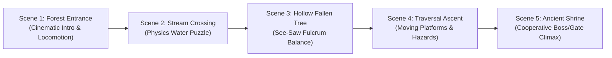

# TPGA-2026-001 — VERTICAL SLICE PROPOSAL: THE WHISPERING FOREST

**Project ID:** TPGA-2026-001  
**Level Name:** The Whispering Forest  
**Target Duration:** 10–15 Minutes of Continuous Cooperative Gameplay  
**Audience Benchmark:** *It Takes Two* (Hazelight)  
**Target Hardware:** Windows PC (NVIDIA RTX 3060 12GB, 32GB RAM)  
**Display Target:** 1080p @ 60–120 FPS in Local Two-Player Split-Screen  

---

## 1. Executive Summary

Rather than scattering effort across an unpolished 8-chapter campaign, the development team will channel all creative and engineering bandwidth into delivering **one single, masterfully polished cooperative vertical slice**: **The Whispering Forest**.

This vertical slice will prove the core commercial pillars:
1. **Expressive Hero Puppies:** Sculpted, rigged, animated Golden Retriever (Bruno) and Corgi (Milo) with secondary ear/tail physics and canine emotional responses.
2. **Tactile Quadruped Locomotion:** Snappy, physics-grounded third-person movement with responsive turning, sprint banking, and grounded landings.
3. **Dynamic Two-Player Split-Screen:** Seamless dual-viewport management that converges when pups are adjacent and splits when exploring separate paths.
4. **Asymmetric Co-op Puzzles:** Interdependent puzzles requiring Bruno's heavy muscle and Milo's agile scent tracking and tight burrowing.
5. **Enchanted Forest World Art:** Ancient mossy trees, volumetric sun rays filtering through the canopy, procedural foliage carpet, and flowing interactive streams.

---

## 2. 5-Scene Narrative & Mechanical Walkthrough

### Scene 1: Forest Entrance (2–3 minutes)
- **Setting:** Golden morning sunlight piercing through an ancient canopy; giant roots carpeted with glowing moss and wildflowers.
- **Cinematic Introduction:** Bruno and Milo scamper down a sunlit hill into the deep woods, paws splashing through damp moss.
- **Gameplay Focus:** Introduces movement, sprinting, jumping, barking, and split-screen camera navigation. First collectible Golden Bone hidden behind a hollow stump.

### Scene 2: Stream Crossing (3 minutes)
- **Setting:** A rushing mountain stream with slippery stones and churning currents.
- **Cooperative Mechanics:**
  - Bruno excavates a riverbank mud dam, causing a waterlogged drift log to float downriver into a natural rock cradle.
  - Milo leaps across the floating log to the opposite shore and toggles an ancient stone winch lever, releasing a tethered bark raft to bring Bruno safely across.

### Scene 3: The Fallen Ancient Oak (2–3 minutes)
- **Setting:** A massive hollowed-out tree trunk suspended across a rocky ravine.
- **Cooperative Mechanics:**
  - The trunk acts as a giant natural see-saw fulcrum.
  - Bruno steps onto the near end to weigh it down, allowing Milo to scramble up the interior trunk.
  - Milo climbs through an upper knothole, emerges onto an overhead bough, and knocks loose a cluster of heavy pinecones onto the far end, locking the see-saw bridge into place for Bruno.

### Scene 4: Briar Traversal Ascent (3 minutes)
- **Setting:** A vertical climb through mossy stone terraces, swinging vine platforms, and prickly briar brambles.
- **Cooperative Mechanics:**
  - Milo activates Scent-o-Vision to reveal safe navigation paths through thorns and squeezes through tiny root burrows.
  - Bruno uses **Snout Boost** to launch Milo onto elevated wooden shelves, where Milo pushes down rope ladders for Bruno.

### Scene 5: The Whispering Shrine Climax (3–4 minutes)
- **Setting:** A clearing housing a monolithic stone canine monument encircled by glowing rune plates and twilight fireflies.
- **Cooperative Climax:**
  - A dual-pressure timing sequence: Bruno and Milo must coordinate simultaneous bark deflections to redirect sunbeams onto the central monument crystals.
  - The monument unlocks, revealing the shimmering **Aura Bone Fragment**, completing the vertical slice with a cinematic chapter-clear fanfare!
